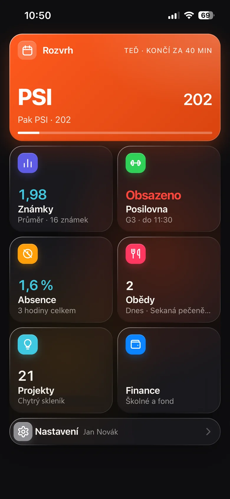
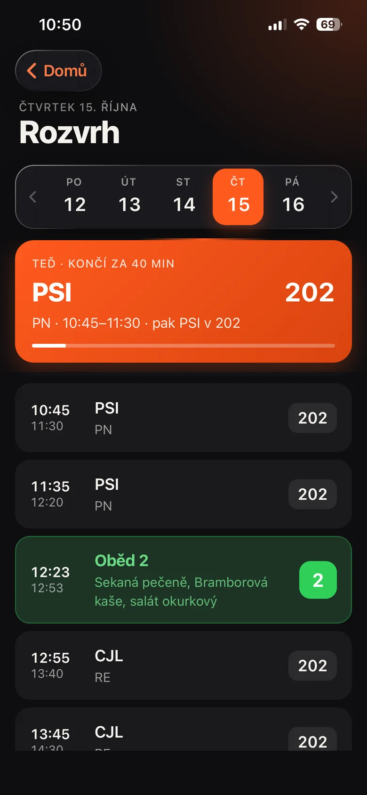
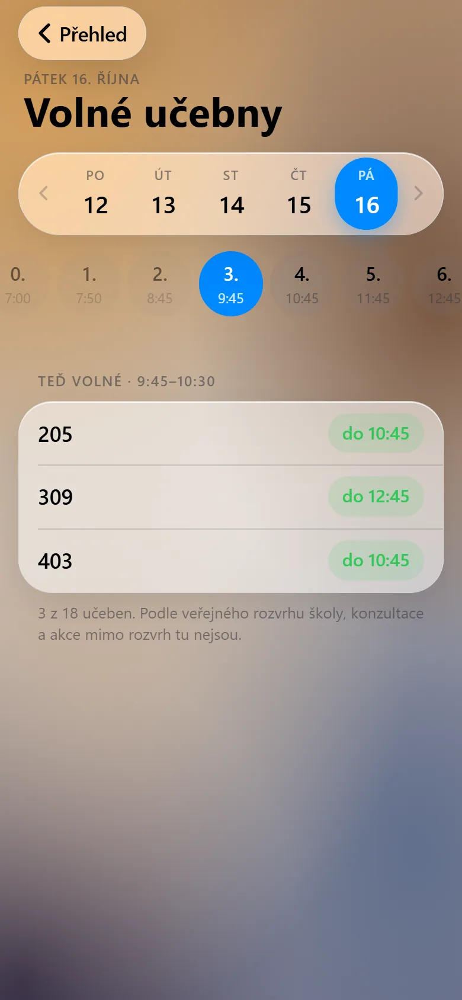
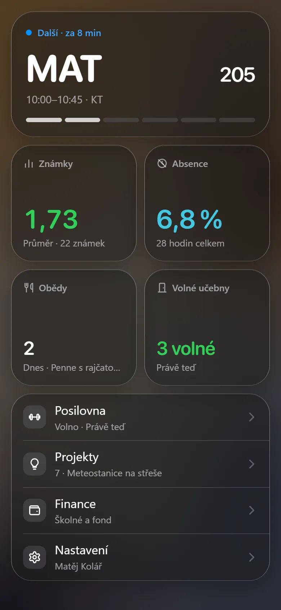
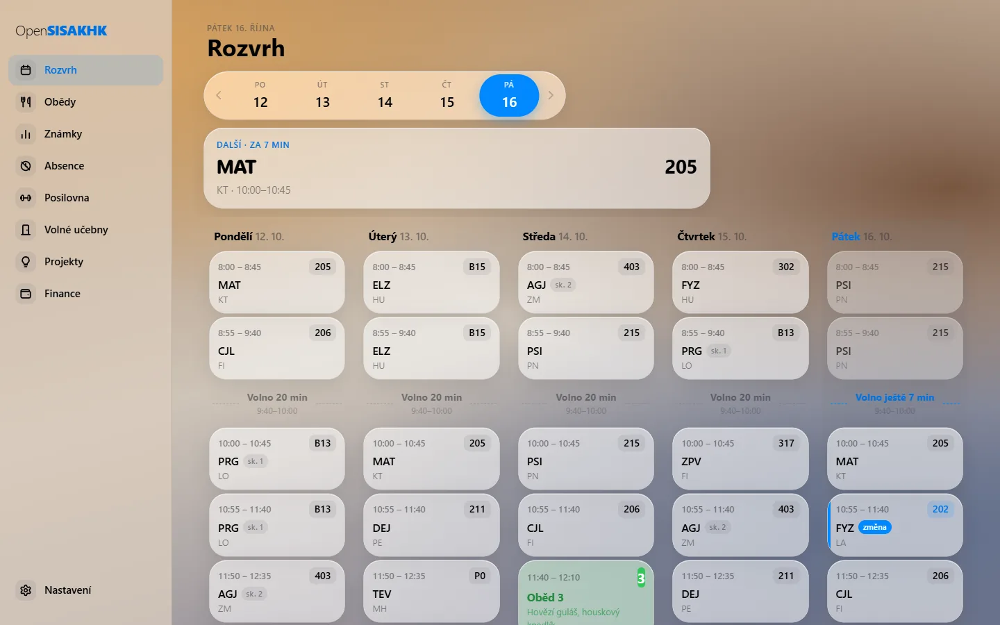

<h1>
  <picture>
    <source media="(prefers-color-scheme: dark)" srcset="brand/wordmark-dark.svg">
    
  </picture>
</h1>

### Kyberna v jedné appce.

Co máš teď a kde. Kolik hodin ještě můžeš vynechat. Kde si sednout ve volné hodině. Co je k obědu. A notifikace, i když
škola přepíše rozvrh ve tři ráno. Pro studenty Kyberny, SŠ a VOŠ aplikované kybernetiky v Hradci Králové.

  
  
  
  

Celé video se zvukem: [promo.mp4](brand/promo.mp4)

<table>
  <tr>
    <td></td>
    <td></td>
    <td></td>
    <td></td>
  </tr>
</table>

---

## Proč

Kyberna nemá Bakaláře, ale vlastní SIS (KybernaIS na sis.ssakhk.cz). Je dělaný na počítač, takže se v něm na
telefonu hledá, přibližuje a ztrácí. OpenSISAKHK bere stejná data a skládá z nich appku, kterou otevřeš jedním
palcem mezi hodinami. Web SIS data jen ukazuje, OpenSISAKHK s nimi počítá a hlídá je za tebe.

## Co umí

**Rozvrh, který ví, co je teď.** Otevře se na aktuální hodině: učebna, odpočet do konce, kam jdeš potom. Suplování a
přesunuté učebny jsou označené, oběd máš přímo mezi hodinami. Po poslední hodině rovnou ukáže zítřek.

**Absence dřív, než je pozdě.** Od 30 % v předmětu tě vyučující nemusí klasifikovat. Appka u každého předmětu ukáže,
jak blízko hranice jsi, **kolik hodin si ještě můžeš dovolit vynechat** a v kalkulačce i které konkrétně.

**Známky a cíl.** Všechny známky s vahou a komentářem. Vybereš si, co chceš mít na vysvědčení, a appka spočítá, co
potřebuješ z další písemky.

**Volné učebny.** Všechny učebny z rozvrhu celé školy mínus ty, kde se zrovna učí. U každé volné vidíš, do kdy volná
zůstane. Vybereš si den i hodinu.

**Obědy na jedno klepnutí.** Propoj účet ze Stravy a jídelníček s objednávkami máš v appce. Objednáš, změníš nebo
zrušíš jedním klepnutím a víš, do kdy to jde.

**Posilovna.** Jestli je teď volná a kdy tam která třída je, ze školního rozvrhu.

**Notifikace, které stojí za to.** Změna tvého rozvrhu, nová známka, nová absence. Škola přepisuje rozvrh hlavně
večer a v noci, appka hlídá nepřetržitě a pošle přesně to, co se změnilo u tebe, třeba
*„Út 13. 10.: 8:00 MAT · 105, 8:55 odpadá“*.

**Projekty a finance.** Projektové volby s obsazeností rolí a tvůj schválený projekt. Školné a fond.

**Po svém.** Nový vzhled ze skla, nebo ten původní černooranžový. Světlý, tmavý, nebo podle telefonu. Deset ikon,
plocha seřazená tak, jak ji používáš. Poslední data ukáže i bez signálu.

**Na počítači celý týden.** V prohlížeči na počítači dostaneš panel se všemi sekcemi a rozvrh na pět dní vedle sebe.

## Jak začít

1. Otevři **[opensisakhk.opensisakhk.workers.dev](https://opensisakhk.opensisakhk.workers.dev)**.
2. Přihlas se stejným jménem a heslem jako do SIS Kyberny (jméno je část školního e-mailu před zavináčem).
3. Na telefonu si ji přidej na plochu:
   - **iPhone:** Safari → Sdílet → *Přidat na plochu*
   - **Android:** Chrome → menu → *Instalovat aplikaci*
4. V Nastavení zapni notifikace a případně propoj Stravu.

## Soukromí

- **Heslo zůstává u tebe.** Je zašifrované v tvém zařízení, server ho při každém požadavku jen použije a zapomene.
- Na server se uloží (zašifrované) jen tehdy, když si zapneš notifikace, jinak by nemohl hlídat změny, když appku
  nemáš otevřenou. Vypnutím nebo odhlášením se smaže.
- **Známky, rozvrh ani absenci server neukládá.** Pro notifikace si pamatuje jen otisky, ze kterých se nic vyčíst nedá.
- Notifikace jsou šifrované, takže ani Google, ani Apple nevidí, co ti přišlo.

Podrobně v [technické dokumentaci](docs/TECHNICKA-DOKUMENTACE.md#co-se-ukládá).

## Časté otázky

**Používá Kyberna Bakaláře?**
Ne. Kyberna (SŠ a VOŠ aplikované kybernetiky Hradec Králové) nemá Bakaláře, ale vlastní školní informační systém SIS
(KybernaIS) na sis.ssakhk.cz, takže aplikace Bakaláři s ním nefunguje. OpenSISAKHK je k němu neoficiální studentský
klient.

**Má Kyberna aplikaci na mobil?**
Oficiální mobilní aplikaci SIS Kyberny nemá, web je dělaný hlavně na počítač. OpenSISAKHK funguje na iPhonu,
Androidu i na počítači jako webová aplikace (PWA), nic se nestahuje z App Storu ani z Google Play.

**Kde najdu rozvrh Kyberny?**
Rozvrh celé školy je v KybernaIS na sis.ssakhk.cz/TimeTable/School, osobní rozvrh se suplováním v SIS po
přihlášení. OpenSISAKHK ho ukáže i s během aktuální hodiny a notifikacemi o změnách.

**Jak najdu volnou učebnu?**
V sekci Volné učebny vybereš den a hodinu a uvidíš všechny učebny, kde se zrovna neučí, i s tím, do kdy zůstanou
volné.

**Je to oficiální SIS Kyberny?**
Ne. Oficiální je KybernaIS na sis.ssakhk.cz. OpenSISAKHK z něj jen čte tvoje data a zobrazuje je přehledněji. Napsal
ji student Kyberny a škola ji nespravuje.

**Kolik to stojí?**
Nic. Je zdarma a bez reklam.

## Pod kapotou

Běží celé zdarma na [Cloudflare Workers](https://workers.cloudflare.com) a GitHub Actions. React a Vite na
frontendu, Hono na serveru, vlastní OCR, které čte rozvrh celé školy z obrázků přímo v telefonu, a Web Push šifrovaný
bez knihoven. Architektura, vývoj a nasazení jsou v [technické dokumentaci](docs/TECHNICKA-DOKUMENTACE.md).

## Podpora

Appka je zdarma a bez reklam. Když ti šetří nervy, můžeš autorovi **[koupit kafe na Ko-fi](https://ko-fi.com/oondraa)**.

## Licence

Kód je veřejný k nahlédnutí, ale **není open source**. Platí
[OpenSISAKHK Personal Use License](LICENSE): appku smíš používat pro sebe a nekomerčně. Šířit ji, provozovat pro
ostatní nebo komerčně využívat je bez písemného svolení autora zakázané. Cizí knihovny, písma a ikony mají vlastní
licence, viz [THIRD_PARTY_LICENSES.md](THIRD_PARTY_LICENSES.md).

---

Studentská aplikace. Není spojená se školou, s autory SIS ani se Strava.cz. Vytvořil
[Ondra](https://github.com/oondraa) · [Ko-fi](https://ko-fi.com/oondraa).
