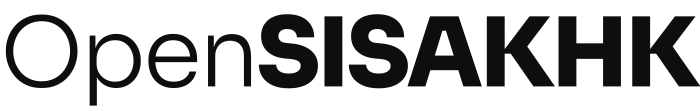
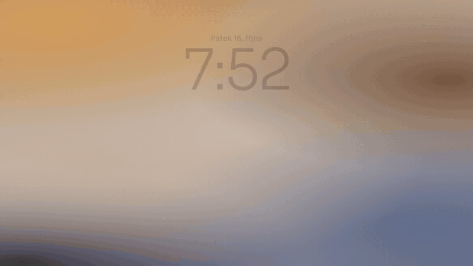

<h1>
  <picture>
    <source media="(prefers-color-scheme: dark)" srcset="brand/wordmark-dark.svg">
    
  </picture>
</h1>

**Školní SIS tak, jak má vypadat v telefonu.**

Rozvrh, který ví, co máš teď. Absence, která tě varuje dřív, než je pozdě. Posilovna, oběd a notifikace, i když
škola přepíše rozvrh ve tři ráno. Pro studenty SŠ a VOŠ aplikované kybernetiky v Hradci Králové.

  
  
  

Celé video se zvukem (21 s): [promo.mp4](brand/promo.mp4)

---

## Proč

SIS je dělaný na počítač. Na telefonu se v něm hledá, přibližuje a ztrácí. OpenSISAKHK bere stejná data a skládá je
do appky, kterou otevřeš jedním palcem mezi hodinami: co mám teď, kde, co je k obědu a jak jsem na tom s absencí.

## Co umí

### Rozvrh, který ví, co je teď
Otevře se rovnou na aktuální hodině. Nahoře karta **Teď / Další** s učebnou a odpočtem, změny od školy jsou
zvýrazněné. Po poslední hodině ti rovnou ukáže zítřek. Mezi dny se přejíždí prstem, u hodin na dálku je odkaz na Meet.

### Oběd přímo v rozvrhu
Propoj účet ve Strava.cz a u oběda uvidíš, jaké číslo máš objednané a co to je. Nebo že nemáš objednáno, dokud je
ještě čas to změnit.

### Absence pod kontrolou
Od 30–35 % absence v předmětu tě vyučující nemusí klasifikovat a jdeš na opravky. OpenSISAKHK to hlídá za tebe: u
každého předmětu ukáže, kolik máš, jak blízko jsi hranici, a hlavně **kolik hodin ještě musíš odchodit**, aby ses
dostal pod ni, nebo kolik si jich můžeš dovolit vynechat do konce pololetí.

### Známky na jednom místě
Všechny známky po předmětech s vahou, typem a komentářem a průměr, který počítá SIS.

### Je posilovna volná?
Jedním pohledem. Appka čte rozvrh celé školy a ukáže, jestli je posilovna teď volná a kdy tam která třída je.

### Notifikace, které stojí za to
Jeden přepínač a víš o všem: **změna tvého rozvrhu**, **nová známka**, **nová absence**. Škola přepisuje rozvrh
hlavně večer a v noci, appka to hlídá nepřetržitě a pošle ti přesně to, co se změnilo u tebe, třeba
*„Út 13. 10.: 8:00 MAT · 105, 8:55 odpadá“*.

### Funguje jako aplikace
Přidáš ji na plochu a chová se jako normální appka: vlastní ikona, celá obrazovka, tmavý režim, a i bez signálu
ukáže poslední načtená data.

## Jak začít

1. Otevři **[opensisakhk.opensisakhk.workers.dev](https://opensisakhk.opensisakhk.workers.dev)** v telefonu.
2. Přihlas se stejným jménem a heslem jako do SIS.
3. Přidej si ji na plochu:
   - **iPhone:** Safari → Sdílet → *Přidat na plochu*
   - **Android:** Chrome → menu → *Nainstalovat aplikaci*
4. V Nastavení si zapni notifikace a případně propoj Stravu.

## Soukromí

- **Heslo zůstává u tebe.** Je zašifrované v tvém zařízení, server ho při každém požadavku jen použije a zapomene.
- Na server se uloží (zašifrované) jen tehdy, když si zapneš notifikace, jinak by nemohl hlídat změny, když appku
  nemáš otevřenou. Vypnutím nebo odhlášením se smaže.
- **Známky, rozvrh ani absenci server neukládá.** Pro notifikace si pamatuje jen otisky, ze kterých se nic vyčíst nedá.
- Notifikace jsou šifrované, takže ani Google, ani Apple nevidí, co ti přišlo.

Podrobně v [technické dokumentaci](docs/TECHNICKA-DOKUMENTACE.md#co-se-ukládá).

## Pod kapotou

Běží celé zdarma na [Cloudflare Workers](https://workers.cloudflare.com) a GitHub Actions. React a Vite na
frontendu, Hono na serveru, vlastní OCR, které čte rozvrh školy z obrázků přímo v telefonu za ~150 ms, a Web Push
šifrovaný bez knihoven. Všechno o architektuře, vývoji a nasazení je v
[technické dokumentaci](docs/TECHNICKA-DOKUMENTACE.md).

## Licence

Kód je veřejný k nahlédnutí, ale **není open source**. Platí
[OpenSISAKHK Personal Use License](LICENSE): appku smíš používat pro sebe a nekomerčně. Šířit ji, provozovat pro
ostatní nebo komerčně využívat je bez písemného svolení autora zakázané. Cizí knihovny, písma a ikony mají vlastní
licence, viz [THIRD_PARTY_LICENSES.md](THIRD_PARTY_LICENSES.md).

---

Neoficiální aplikace. Není spojená se školou, s autory SIS ani se Strava.cz. Vytvořil
[Ondra](https://github.com/oondraa).
